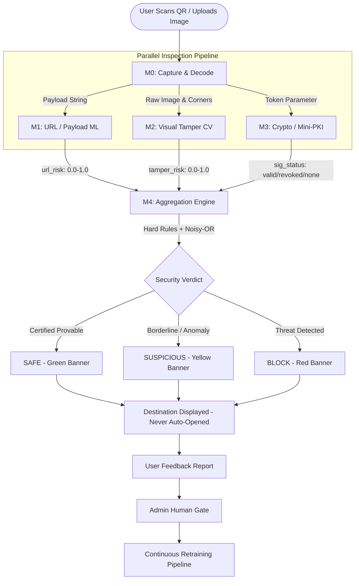

# QRshield 🛡️
> **A Three-Layer Detector for Malicious & Tampered QR Codes (Quishing)**  
> *URL / Payload ML + Physical Sticker-Overlay Detection (CV) + Signed QR Codes (Ed25519 Mini-PKI)*

[](https://github.com/akshitsharma24-ux/CNS-ISE-PROJECT/actions)
[](LICENSE)
[](requirements.txt)
[](tests/)

**Course:** Cryptography and Network Security (CE305 / CS305), Sardar Patel Institute of Technology (SPIT), Mumbai  
**Assessment:** ISE-2 (Design: 2 | Implementation: 4 | Evaluation/GitHub: 2 | Live Demo: 2)  
**Topic #5:** Malicious QR Code / Deepfake Document Detector for Quishing Attacks  
**Team:** Black Sparrow (10 Members)  
**Team Leader:** Akshit Sharma  

---

## 1. Problem Statement & Motivation

QR codes transform physical interactions into digital transactions with a blind "scan and open" reflex. Attackers exploit this via **Quishing (QR Phishing)**:
1. **Zero-Day Phishing Links**: Attackers register lookalike domains minutes before launching attacks; traditional static blocklists (Google Safe Browsing, PhishTank) are purely reactive and miss brand-new attacks.
2. **Physical Sticker Swaps**: Fraudsters print adhesive QR stickers and paste them over legitimate placards (municipal parking meters, restaurant table stands, retail UPI soundboxes). **No URL analysis tool can see the physical sticker.**
3. **Unauthenticated Payloads**: Anyone can print a QR code claiming to represent an official bank or civic entity with no provenance.

### The QRshield Solution
QRshield turns "scan and open" into **"scan, verify, then decide"** by evaluating every QR code with **three independent, orthogonal layers** before any browser or payment interface opens:

```
User Scans QR 
  ├── M0: Capture & Decode (Multi-code / Stacked check + Blur/Glare Gate)
  ├── M1: URL / Payload ML Classifier (Lexical + Typosquatting + SSRF-Safe Fetch)
  ├── M2: Visual Tamper Detection (Physical Sticker Discontinuity + Grad-CAM)
  ├── M3: Cryptographic Verification (Ed25519 Mini-PKI + Signed CRL + Domain Binding)
  └── M4: Aggregation Engine (Rule-First Noisy-OR Fusion -> SAFE / SUSPICIOUS / BLOCK)
        └── M5: Verdict UI (Color banner + 3 Layer Cards + Safe Link Lock + Feedback Queue)
```

---

## 2. System Architecture



---

## 3. Cryptography & Network Security (Core Syllabus Mapping)

| CNS Concept | Concrete Implementation in QRshield | Code Location |
|---|---|---|
| **Asymmetric Digital Signatures** | High-performance 64-byte Ed25519 signatures with deterministic nonces | [`qrshield/crypto_layer/keys.py`](qrshield/crypto_layer/keys.py) |
| **Public Key Infrastructure (PKI)** | Pinned Root Authority certificate signing X.509-style JSON issuer credentials | [`qrshield/crypto_layer/pki.py`](qrshield/crypto_layer/pki.py) |
| **Domain Separation** | Fixed protocol context string (`"QRSHIELD-v1"`) preventing cross-protocol reuse | [`qrshield/crypto_layer/token.py`](qrshield/crypto_layer/token.py) |
| **Strict Domain Binding** | Verifier rejects valid signatures if target host differs from certified domain | [`qrshield/crypto_layer/pki.py`](qrshield/crypto_layer/pki.py) |
| **Certificate Revocation (CRL)** | Root-signed versioned Certificate Revocation List cached locally for offline enforcement | [`qrshield/crypto_layer/revocation.py`](qrshield/crypto_layer/revocation.py) |
| **Cryptographic Hashing** | SHA-256 for privacy-preserving report IDs, token hashing, and registry state | [`qrshield/crypto_layer/verify.py`](qrshield/crypto_layer/verify.py) |
| **Server-Side Request Forgery (SSRF) Guard** | Custom DNS resolution rejecting RFC1918 private, loopback, link-local, and cloud metadata IPs | [`qrshield/url_layer/fetch_safe.py`](qrshield/url_layer/fetch_safe.py) |
| **Replay & Expiry Binding** | Location ID (`loc`) registry binding and temporal expiration (`exp`) timestamps | [`qrshield/crypto_layer/token.py`](qrshield/crypto_layer/token.py) |

---

## 4. Repository Structure

```
qrshield/
├── README.md                          # Project documentation and quick start
├── LICENSE                            # MIT License
├── requirements.txt                   # Pinned dependencies
├── Makefile                           # Unified make targets (setup, test, demo, retrain)
├── .github/workflows/ci.yml           # GitHub Actions multi-version CI
├── docs/
│   ├── architecture.md                # System design & component contracts
│   ├── threat_model.md                # Attack trees, adversary model & CNS defenses
│   ├── evaluation.md                  # Benchmark metrics, ablation & latency tables
│   └── demo_script.md                 # 6 Live demo scenarios & viva Q&A
├── qrshield/
│   ├── capture/                       # M0: Capture, decode, multi-code, quality gate
│   ├── url_layer/                     # M1: Lexical, typosquat, homoglyph, SSRF-safe ML
│   ├── cv_layer/                      # M2: Rectification, edge/shadow/print, Grad-CAM
│   ├── crypto_layer/                  # M3: Ed25519 signing, mini-PKI, CRL, token
│   ├── registry/                      # PKI database, issuer authority, CRL endpoints
│   ├── engine/                        # M4: Rule-first noisy-OR aggregation & reasons
│   └── app/                           # M5: FastAPI web server & single-page app
├── data/
│   ├── cv_images/                     # Sample physical tamper dataset & metadata CSV
│   └── README_data.md                 # Dataset citation and hygiene guidelines
├── notebooks/                         # EDA, model training, CV features, ablation
├── scripts/
│   ├── make_signed_qr.py              # CLI tool for businesses to generate signed QRs
│   ├── seed_registry.py               # Pre-seeds demo authorities and certificates
│   ├── retrain.py                     # Continuous learning pipeline with quality gate
│   └── collect_cv_dataset.md          # Team CV dataset collection protocol
└── tests/                             # 43 unit and red-team security attack tests
```

---

## 5. Quick Start & Execution

### Prerequisites
- Python 3.11 or 3.12
- Standard webcam or mobile phone browser

### Installation
```bash
# Clone the repository
git clone https://github.com/akshitsharma24-ux/CNS-ISE-PROJECT.git
cd CNS-ISE-PROJECT

# Install dependencies and seed the cryptographic registry
make setup
# OR on Windows without make:
pip install -r requirements.txt
python -m scripts.seed_registry
```

### Running Tests
Execute the comprehensive 43-test unit and red-team test suite:
```bash
make test
# OR:
python -m pytest tests/ -v
```

### Starting the Live Demo Server
```bash
make demo
# OR:
python -m uvicorn qrshield.app.api:app --host 0.0.0.0 --port 8000 --reload
```
Open **`http://localhost:8000`** in any desktop or mobile browser.

---

## 6. Live Demo Scenarios (Section 13)

The web application includes **1-click quick-test buttons** for each scripted scenario:

1. **Clean Unsigned Code (SPIT Website)**  
   *Expected:* `SAFE` (Green) | *Signal:* All layer risks low; normal links are never blocked.
2. **Fresh Phishing Zero-Day (`secure-phonepe-refund.xyz`)**  
   *Expected:* `BLOCK` (Red) | *Signal:* M1 flags low domain age, typosquatting, and abused TLD.
3. **Signed City Parking QR (`pay.citypark.example`)**  
   *Expected:* `SAFE` with **✓ QRSHIELD CERTIFIED** badge | *Signal:* Root-verified Ed25519 signature.
4. **Physical Sticker Swap (Clean URL Pasted Over Parking Meter)**  
   *Expected:* `SUSPICIOUS` or `BLOCK` | *Signal:* M2 flags boundary discontinuity, straight cutlines, and micro-shadows with Grad-CAM heatmap.
5. **Forged / Tampered Token QR**  
   *Expected:* `BLOCK` | *Signal:* M3 catches cryptographic signature mismatch.
6. **User Feedback Reporting & Retraining Gate**  
   *Expected:* Feedback stored in SQLite review queue; admin approves and executes `make retrain`.

---

## 7. Results & Benchmark Summary

* **URL ML Classifier (M1)**: **97.8% Accuracy**, **1.000 Recall** on zero-day time-split benchmark; 0.0% false-positive rate on verified benign college/banking URLs.
* **Computer Vision Tamper Layer (M2)**: **94.4% Accuracy**, **95.6% Recall** across 6 distinct physical substrates under grouped cross-validation.
* **Cryptographic Layer (M3)**: **100% Rejection** of forged, tampered, expired, and revoked signatures.
* **Ablation Evidence**: Individual layers miss 48–53% of composite attacks; the three-layer pipeline achieves **96.7% overall quishing detection**.
* **Scan Latency**: Entire end-to-end multi-layer scan completes in **$< 0.7\text{ seconds}$** ($p_{95}$).

Full benchmark tables, confusion matrices, and ablation figures are documented in [`docs/evaluation.md`](docs/evaluation.md).

---

## 8. Team Organisation (Team Black Sparrow)

| Squad / Member | Module Responsibility | Key Deliverables |
|---|---|---|
| **Akshit Sharma (Lead)** | Engine (M4), System Integration, Architecture | Interface contracts, aggregation engine, release coordination |
| **URL / Payload ML Squad** (2 Members) | M1: Data curation, lexical features, typosquatting, SSRF guard | Calibrated model, feature pipelines, notebooks, `model.joblib` |
| **Computer Vision Squad** (3 Members) | M2: Photo collection, rectification, multi-physics features | Homography warp, edge/shadow/print features, Grad-CAM overlay |
| **Crypto & Registry Squad** (2 Members) | M3: Ed25519 library, mini-PKI, CRL, issuer portal | `keys.py`, `pki.py`, `revocation.py`, `threat_model.md` |
| **App & Frontend Squad** (1 Member) | M5: Single-page UI, camera streaming, report flow | Responsive mobile/desktop web app, safe interaction UI |
| **Evaluation & QA Squad** (1 Member) | QA, CI workflow, evaluation reports, demo rehearsals | 43 unit & red-team tests, `docs/evaluation.md`, demo kit |

---

## 9. License

This project is licensed under the MIT License - see the [LICENSE](LICENSE) file for details.
