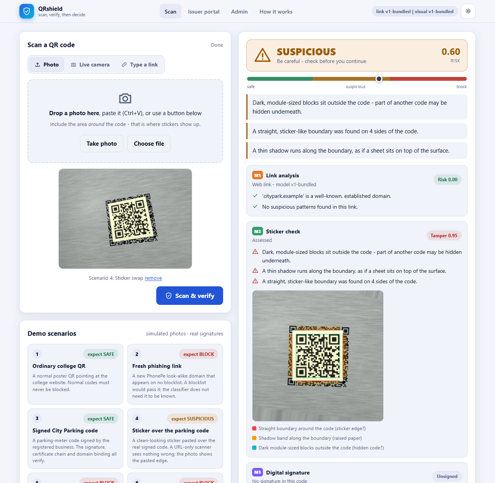

# QRshield

**Scan, verify, then decide.** A three-layer detector for malicious and tampered QR codes ("quishing"): link analysis + a pasted-sticker check + Ed25519 signed codes with a mini-PKI.

[](https://github.com/akshitsharma24-ux/CNS-ISE-PROJECT/actions)
[](LICENSE)


**Course:** Cryptography and Network Security (CE305/CS305), SPIT Mumbai - ISE-2 / ACNS-DC 2026-27 &nbsp;|&nbsp; **Team Black Sparrow** (leader: Akshit Sharma)

## The problem

A QR code is a link you cannot read. Attackers exploit that in two ways: **new look-alike links** that no blocklist has seen, and **stickers pasted over real codes** (parking meters, menus, payment stands). A URL checker cannot see a sticker, a camera check cannot read a link, and signed codes only help businesses that sign. QRshield layers all three so each covers the others' gap, and shows the result **before anything opens**.

| Layer | Question it answers | How |
|---|---|---|
| **M1 link analysis** | is this link a look-alike / scam? | calibrated LightGBM + character n-gram model, brand-impersonation rules over *official registered domains*, UPI payee checks, SSRF-safe look at shorteners |
| **M2 sticker check** | does this physical code look pasted over something? | rectify the photo onto the QR plane, 48 physical features (boundaries, shadow, paper colour, grain, gloss, hidden-original fragments), calibrated model, evidence overlay |
| **M3 signature check** | did a registered business really issue this exact code? | Ed25519 token in the URL, root-signed issuer certificate, domain binding, signed + versioned revocation list, key rotation |
| **M4 engine** | what should the user do? | crypto facts first, then noisy-OR fusion; visual evidence alone can never BLOCK; every verdict shows its working |



## Quick start

**Windows (no `make` needed):** double-click **`run_demo.bat`**. It creates a virtual environment, installs dependencies, seeds the registry and opens <http://127.0.0.1:8000>.

**Any OS:**
```bash
python -m venv .venv && . .venv/bin/activate      # Windows: .venv\Scripts\activate
pip install -r requirements.txt
python -m qrshield setup        # keys + demo registry + self-check; prints the admin token
python -m qrshield serve        # http://127.0.0.1:8000
```
Python 3.11 or 3.12. `python -m qrshield doctor` diagnoses a broken install.

**Phone camera:** browsers allow the live camera only over HTTPS (or localhost). Either use *Photo > Take photo* (opens the phone's camera app, works over plain http) or run `python -m qrshield serve --https --host 0.0.0.0` and open the printed `https://<laptop-ip>:8000` on the phone (accept the self-signed certificate once).

**Admin features** (Issuer portal, Admin console) need the admin token printed at start-up (also in `.qrshield/admin_token`; set `QRSHIELD_ADMIN_TOKEN` to choose your own).

**Live demo props:** `python -m qrshield demo-assets` writes an A4 sheet with the six demo codes; `docs/demo_script.md` has the full script and viva Q&A. The six scenarios are also available as one-click simulated photos in the UI.

## Cryptography and network security map

| CNS concept | What QRshield does | Code |
|---|---|---|
| Digital signatures | Ed25519 over a domain-separated, canonicalised message; 64-byte signature in a ~140-character token | [`crypto_layer/token.py`](qrshield/crypto_layer/token.py), [`keys.py`](qrshield/crypto_layer/keys.py) |
| PKI / certificates | pinned root key, root-signed issuer certificates bound to a domain and key id | [`pki.py`](qrshield/crypto_layer/pki.py), [`registry/`](qrshield/registry/service.py) |
| Domain binding | a genuine issuer cannot certify a look-alike host; bare suffixes cannot be certified | [`pki.py`](qrshield/crypto_layer/pki.py) |
| Revocation | root-signed versioned CRL, per-key revocation, key rotation, rollback protection | [`revocation.py`](qrshield/crypto_layer/revocation.py), [`verify.py`](qrshield/crypto_layer/verify.py) |
| Fail-closed verification | no trust anchor -> nothing verifies; signature checked *before* expiry/domain | [`verify.py`](qrshield/crypto_layer/verify.py) |
| Hashing | SHA-256 payload fingerprints for reports and telemetry | [`registry/service.py`](qrshield/registry/service.py) |
| SSRF defence | resolve once, globally-routable IPs only, connect to the validated IP (DNS-rebinding-proof), re-validate every redirect | [`url_layer/fetch_safe.py`](qrshield/url_layer/fetch_safe.py) |
| Secure parsing of hostile input | size/pixel limits before decoding, parsers that never raise, canonical URLs, userinfo rejected | [`capture/decode.py`](qrshield/capture/decode.py), [`netutil.py`](qrshield/netutil.py) |
| Web hardening | strict CSP, no inline script, admin token (constant-time), rate limits, append-only audit log | [`app/security.py`](qrshield/app/security.py) |
| Poisoning defence | human review + fixed-benchmark + canary gate before a model is promoted | [`retrain.py`](qrshield/retrain.py) |

Details and the attack-by-attack table with the test that proves each defence: [`docs/threat_model.md`](docs/threat_model.md), [`docs/architecture.md`](docs/architecture.md).

## Measured results

<!-- RESULTS:START -->
| Component | Result |
|---|---|
| M1 link model (real public corpora) | ROC-AUC **0.9434** on an external corpus it never trained on (domain-disjoint split: 0.9425); flags 90.5% of 20,277 phishing links from 2026 feeds at the 0.5 threshold |
| M2 sticker check (**simulated** photos) | ROC-AUC **0.8805** on surfaces it never saw; catches 99.1% of offset/rotated and 97.8% of smaller stickers, but only 47.5% of exact-fit ones (physically close to a genuine sticker) |
| End-to-end ablation (simulated photos, real pipeline) | all three layers flag **77.8%** of attacks vs 30.0% for the best single layer (cv_only); false alarms on genuine codes: 8.1%; median scan 97.4 ms |
| M3 signatures | forged, edited, expired, revoked, rolled-back, cross-domain and rogue-root tokens are all rejected - see `tests/test_crypto.py`, `tests/test_redteam.py` |
<!-- RESULTS:END -->

Full methodology, per-style and per-surface tables, ablations and limitations: [`docs/evaluation.md`](docs/evaluation.md) (generated from `docs/results/*.json`; nothing is typed by hand).

## Honest limitations

* The sticker model is trained on **simulated** photographs. Add real photos (`scripts/collect_cv_dataset.md`) to measure real-world accuracy.
* A **perfectly fitted** sticker over an *unsigned* code is close to indistinguishable from a genuine sticker; the sticker layer catches imperfect covers. Signing the original code is what closes this gap.
* A signature proves who issued a payload, **not** that a physical code was never copied (replay). Location binding, expiry and the sticker check limit - not eliminate - this.
* The link model is statistical (class-balanced training; scores are not real-world probabilities).

## Repository layout

```
qrshield/
  capture/        M0  decode (zxing-cpp + OpenCV fallbacks), payload typing, quality gate, stacked-code check
  url_layer/      M1  features, brands, UPI, SSRF-safe fetch, models, training, corpus builder
  cv_layer/       M2  rectification, features, model, simulator, evidence overlay, second photo, training
  crypto_layer/   M3  Ed25519 tokens, PKI, CRL, trust store + verification
  registry/           issuer lifecycle, key custody, CRL publication, feedback queue, audit log
  engine/         M4  rule-first fusion + plain-language reasons
  app/            M5  FastAPI + single-page UI (static/: HTML, CSS, ES modules - no build step)
  models/             trained models + retraining base corpus
scripts/              dataset build, evaluation, report generator, demo assets, signed-QR CLI
tests/                unit, security/red-team, pipeline and browser (Playwright) tests
docs/                 architecture, threat model, evaluation (generated), demo script
```

## Development

```bash
pip install -r requirements-dev.txt
python -m pytest                       # everything except browser tests
python -m pytest -m e2e                # browser tests (pip install playwright; playwright install chromium)
python -m qrshield data                # download public corpora, build the URL training pool   (requirements-train.txt)
python -m qrshield train-url           # retrain the link model
python -m qrshield train-cv [--real data/cv_images]
python -m qrshield evaluate            # end-to-end ablation
python -m scripts.make_eval_report     # regenerate docs/evaluation.md and the table above
```

Runtime state (registry database, **private keys**, admin token, retrained models, certificates) lives in `.qrshield/`, which is git-ignored. No key is ever committed.

## Team Black Sparrow

Akshit Sharma (lead), Miti Shah, Jalak Shah, Maisha Vageria, Param Rajgor, Rahil Shah, Shrey Vadhani, Tanvi Sheth, Twissha Shah, Dhyani Sanghvi.

## Licence

MIT - see [LICENSE](LICENSE). Datasets keep their own licences (see [`data/README_data.md`](data/README_data.md)).
