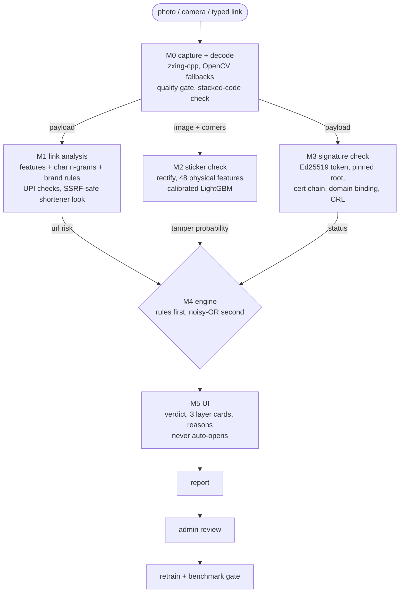

# QRshield architecture

QRshield turns "scan and open" into **scan, verify, then decide**. Three independent layers inspect every code; a rule-first engine fuses them into one verdict that the UI shows *before* anything opens.



## Module contracts

All modules exchange plain dicts and are importable without the web app.

| Function | Returns |
|---|---|
| `capture.capture_and_decode(bytes)` | `{success, payload, payload_type, corners, quality, multi_code, codes, image, error}` |
| `url_layer.analyze(payload)` | `{score 0..1, payload_type, signals[{name,value,text,direction}], details}` - `score` is the *decision-scale* risk |
| `cv_layer.analyze(img, img2=None, corners=None)` | `{score, status ok\|inconclusive\|low_quality\|not_applicable, signals, heatmap_png_b64, details}` - `score` is a calibrated tamper probability |
| `crypto_layer.verify(payload, store=None)` | `{status none\|valid\|invalid\|unknown_issuer\|revoked\|expired\|domain_mismatch, issuer, detail}` |
| `engine.decide(url, cv, sig)` | `{verdict SAFE\|SUSPICIOUS\|BLOCK, risk, certified, reasons<=3, breakdown}` |

## M3 - the cryptographic core

```
Registry root key (Ed25519; private key offline/0600, PUBLIC key pinned in the verifier)
   | signs
   v
Issuer certificate  { issuer_id, name, domain, kid, issuer_pubkey, valid_from, valid_to }   context "QRSHIELD-CERT-v1"
   | issuer private key signs
   v
QR token  0x01 | iat u32 | exp u32 | len+issuer | len+key id | len+location | Ed25519 signature (64 B)
          carried as one base64url URL parameter:  https://pay.citypark.example/m/42?qrs=...
Signed message:  "QRSHIELD-v1" 00 canonical_url 00 issuer 00 kid 00 location 00 iat 00 exp
```

* **Graceful degradation.** The token rides in a query parameter, so any phone camera still opens the business URL. A signed code is ~190 bytes (error-correction level M), well inside the plan's 250-byte budget; a JSON token would have been ~320.
* **Domain separation.** Fixed context strings (`QRSHIELD-v1`, `QRSHIELD-CERT-v1`, `QRSHIELD-CRL-v1`) mean a signature can never be replayed as another message type.
* **Canonicalisation.** Lower-case scheme/host, default port and fragment dropped, `qrs` stripped, query sorted, userinfo (`user@host`) rejected. Signer and verifier share one function.
* **Verification order** (every failure is *closed*; no pinned root means nothing verifies):
  1. no `qrs` -> `none` (unsigned, not an error); malformed -> `invalid`
  2. certificate unknown, not signed by the pinned root, or outside its validity -> `unknown_issuer`
  3. issuer or `issuer:kid` on the CRL -> `revoked`
  4. Ed25519 signature over the canonical URL -> `invalid` on failure
  5. URL host outside the certified domain -> `domain_mismatch`
  6. past `exp` -> `expired`; otherwise `valid`

  The signature is checked **before** expiry/domain are trusted: a forged token can never downgrade itself to the milder "expired" verdict.
* **Revocation.** Root-signed, versioned CRL. Verifiers refuse older versions (rollback protection) and lists signed by another key. Entries are `issuer` or `issuer:kid`, so a key can be rotated without revoking the business.
* **Hashing.** SHA-256 for payload fingerprints in reports/telemetry. Ed25519 uses SHA-512 internally.

## M1 - link analysis

* Features are computed from the URL *string only* (no live lookups feed the model), so training and serving see identical inputs. The scheme and `www.` are not features.
* Two models are blended and isotonic-calibrated: LightGBM on 49 structured features (host shape, brand impersonation, path/query), and a hashed character 3-5-gram logistic model. Explanations come from tree-SHAP contributions mapped to sentences.
* Brand logic uses *official registered domains* per brand: `paytm.xyz` is impersonation even though its label is exactly "paytm". Short brand names match on whole tokens only (`accredited.org` is fine), homoglyphs and punycode are normalised.
* Rules sit on top where being wrong is asymmetric: brand impersonation floors the risk, official / well-known / institution-only (`.gov.in`, `.ac.in`) domains cap it. Platforms that let anyone publish (`pages.dev`, `github.io`, shorteners...) never earn a trust discount.
* **SSRF-safe inspection** of shorteners (`fetch_safe.py`): DNS is resolved once by us, every address must be globally routable, the socket connects to *that* IP (no second resolution - rebinding-proof), every redirect hop is re-validated, HEAD only, 3 s timeout, 5 hops.

## M2 - sticker check

The photo is warped (homography from the decoded corners) onto a 384x384 canvas with the code centred and one QR-width of surface around it, so every feature is in canonical units. 48 features compare the code region with its surroundings: per-side straight boundaries, shadow bands, paper colour/white-point, print grain and LBP texture, highlights, ink-dark module-sized blobs *outside* the code (a hidden original), quiet-zone cleanliness and enclosing frames. A small calibrated LightGBM turns them into a tamper probability. The UI overlay draws the *measured evidence* (boundaries, shadow bands, blobs), not a decorative heat-map. Training data is simulated (`simulate.py`) with an option to mix in real photos - see `docs/evaluation.md` for exactly what that does and does not prove.

## M4 - engine

1. Cryptographic facts decide first: `valid` -> SAFE + certified (downgraded to SUSPICIOUS if the sign physically looks pasted over); `invalid`/`unknown_issuer`/`revoked`/`domain_mismatch` -> BLOCK; `expired` -> at least SUSPICIOUS.
2. Unsigned codes: `risk = 1 - (1 - a*url)(1 - b*tamper)` with a = 0.95, b = 0.60 (0.35 if the photo was borderline). The tamper probability is first rescaled (<= 0.40 = nothing). Because b < 0.65, **visual evidence alone can never BLOCK**. Two layers agreeing (> 0.5 each) floors the risk at 0.85. SAFE < 0.30 <= SUSPICIOUS < 0.65 <= BLOCK.
3. Hard overrides: blocklist hit / dangerous scheme -> BLOCK; stacked codes, UPI payee mismatch, two photos decoding differently -> at least SUSPICIOUS.

Every response carries a `breakdown` (inputs, weights, fused value, rules applied, timings) which the UI shows under "Show the working".

## Web app and API

`qrshield/app/api.py` exposes `create_app()` (isolated registry/trust-store per instance; used by the tests) and a lazy module-level `app` for `uvicorn`.

| Route | Auth | Purpose |
|---|---|---|
| `POST /api/scan` (image, image2?) | public, 40/min | full pipeline |
| `POST /api/check` | public | link/payload only (no photo) |
| `POST /api/report` | public, 12/min | feedback into the review queue |
| `GET /api/registry/{root,crl,issuers,issuers/{id}/cert}`, `POST /api/registry/verify` | public | transparency |
| `GET /api/demo/scenarios`, `/api/demo/scenario-image/{1-6}` | public | the six demo scenarios |
| `GET /api/health`, `/api/results` | public | status, measured metrics |
| `/api/admin/*` (sign, issuers, revoke/restore/rotate, reports, retrain, models, audit) | `X-Admin-Token` | privileged operations |

Hardening: strict CSP (no inline script or style, `connect-src 'self'`), `nosniff`, frame denial, upload size and pixel limits enforced before decoding, sliding-window rate limits, constant-time token comparison, append-only audit log, no CORS (same-origin app).

## Runtime state (never committed)

`.qrshield/` (override with `QRSHIELD_HOME`): `registry.db`, `keys/root.json` + `keys/issuers/*.json` (0600), `admin_token`, retrained models, certificates for `--https`, caches. Models that ship with the repo live in `qrshield/models/`; a promoted retrain takes precedence without a restart.

## Human-gated learning

`report -> admin approves -> candidate trained on base corpus + approved rows -> must not be worse than the active model on a fixed benchmark AND get all canary links right -> promoted`. The gate, not just the human, is what stops mass-reporting from poisoning the live model; see `tests/test_retrain.py`.
