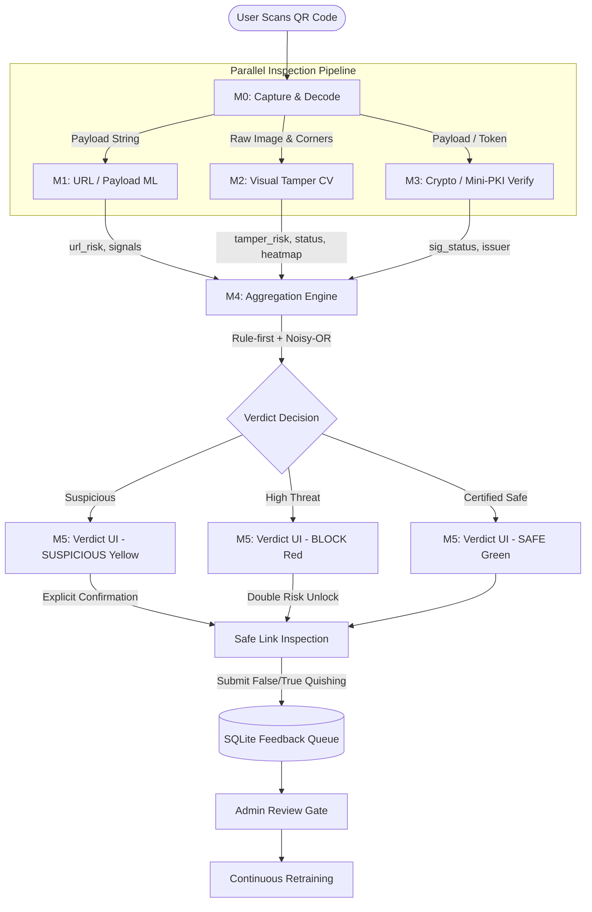
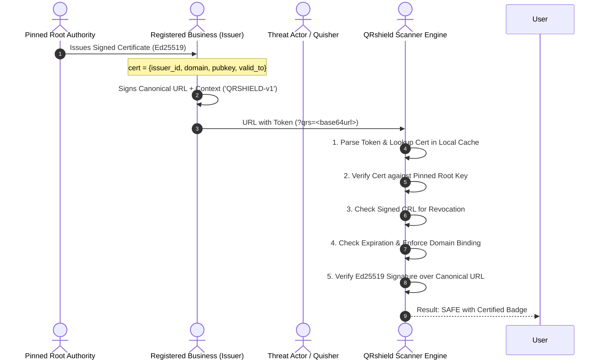

# QRshield System Architecture (F40)

QRshield is a defense-in-depth, three-layer detector against malicious and physically tampered QR codes (quishing). Rather than relying on simple reactive blocklists, QRshield fuses **cryptographic digital signatures**, **computer vision physical sticker analysis**, and **machine-learned lexical/network telemetry** into an authoritative verdict before any link opens.

---

## 1. High-Level Architecture Diagram



---

## 2. Module Specifications and Interface Contracts

Each component exposes a frozen interface signature returning plain Python dictionaries:

```python
# M1: URL / Payload Classifier
url_layer.analyze(payload: str) -> {
    "score": float,            # 0.0 to 1.0 (malicious probability)
    "payload_type": str,       # "url" | "upi" | "other"
    "signals": [
        {"name": str, "value": Any, "text": str}
    ]
}

# M2: Computer Vision Physical Tamper Layer
cv_layer.analyze(img: bytes, img2: bytes | None = None) -> {
    "score": float,            # 0.0 to 1.0 (tamper probability)
    "status": str,             # "ok" | "inconclusive" | "low_quality"
    "signals": [...],
    "heatmap_png_b64": str | None  # Data URI base64 PNG Grad-CAM overlay
}

# M3: Cryptographic PKI Verification Layer
crypto_layer.verify(payload: str) -> {
    "status": str,             # "none" | "valid" | "invalid" | "unknown_issuer" | "revoked" | "expired" | "domain_mismatch"
    "issuer": {
        "name": str,
        "domain": str,
        "key_id": str,
        "issuer_id": str
    } | None
}

# M4: Aggregation and Scoring Engine
engine.decide(url_res: dict, cv_res: dict, sig_res: dict) -> {
    "verdict": str,            # "SAFE" | "SUSPICIOUS" | "BLOCK"
    "risk": float,             # 0.0 to 1.0
    "certified": bool,
    "reasons": [str, ...]      # Up to 3 plain-language explanations
}
```

---

## 3. Cryptographic Mini-PKI Design



### Token Format and Canonical Encoding
Signed QR codes embed the token as a single URL parameter `qrs`:
```
https://pay.citypark.example/m/42?qrs=<base64url(token)>
```
Normal scanners without QRshield open the destination URL directly without crashing (**Graceful Degradation**).

#### Token JSON Structure:
```json
{
  "v": 1,
  "iss": "citypark-01",
  "kid": "key-1",
  "loc": "andheri-counter-04",
  "iat": 1775630000,
  "exp": 1775716400,
  "sig": "MEQCIA..."
}
```

#### Canonical Byte Representation:
```
msg = "QRSHIELD-v1\x00" + canonical_url + "\x00" + iss + "\x00" + kid + "\x00" + loc + "\x00" + iat + "\x00" + exp
```
* **Domain Separation**: Prefixed with `"QRSHIELD-v1"` to prevent cross-protocol signature reuse.
* **Domain Binding**: The certificate specifies `domain: "pay.citypark.example"`. If an attacker copies the token or a valid issuer attempts to sign an external domain (e.g. `scam.com`), the verifier rejects it with `domain_mismatch`.

---

## 4. Multi-Physics Computer Vision Pipeline (M2)

1. **Homography Rectification (F14)**: Uses detected corner points to warp the QR code and its surrounding perimeter (1.5x width) into a normalized 300x300 canvas.
2. **Three Analytical ROIs**:
   * *QR Core*: Inner modules containing payload matrix.
   * *Quiet-Zone Ring*: Immediate white margin around the code.
   * *Surface Ring*: Host substrate context (metal, wood, plastic).
3. **Feature Extraction**:
   * *Boundary Discontinuity (F15)*: Sobel gradient energy, Canny edge detection, straight Hough cutline parallel tracking.
   * *Illumination & Micro-Shadows (F16)*: Surface luminance plane fitting in LAB color space; perpendicular edge luminance drops detecting 3D physical sticker elevation.
   * *Specular Gloss Differential (F16)*: HSV saturation/brightness histograms identifying vinyl stickers on matte surfaces.
   * *Halftone & Print Quality (F17)*: Laplacian variance ratio (DPI disparity) and 2D FFT radial spectrum peaks identifying moiré patterns.
   * *Texture Mismatch (F17)*: Local Binary Patterns (LBP) chi-square divergence between quiet zone and host surface.
4. **Grad-CAM Visual Heatmap (F20, F37)**: Produces an overlay highlighting detected sticker edges in bright red/orange.
5. **Multi-Angle Second Photo (F21)**: If tamper risk is borderline (0.38–0.62), prompts user for an oblique ~30° shot. Aligns both frames via ORB features and evaluates parallax/photometric disparity.

---

## 5. Decision Fusion & Safety Rules (M4 & M5)

1. **Rule-First, Score-Second**:
   * Cryptographic verification results take absolute precedence.
   * A valid certificate awards `SAFE` with a `Certified` badge (unless physical sticker tampering is detected, which downgrades to `SUSPICIOUS`).
   * A fake, revoked, or domain-mismatched token forces `BLOCK`.
2. **Unsigned Noisy-OR Fusion**:
   For unsigned QR codes, risk is computed via independence fusion:
   $$\text{risk} = 1 - (1 - a \cdot \text{url\_risk}) \cdot (1 - b \cdot \text{tamper\_risk})$$
   * Agreement boost: If both URL and CV layers exceed 0.50 risk, minimum risk is locked to $\ge 0.85$.
3. **Safe Link Interaction (F33)**:
   * Links are **never automatically opened**.
   * On `SUSPICIOUS`, the user must check a risk acknowledgment box.
   * On `BLOCK`, the button is locked behind an explicit override warning.
